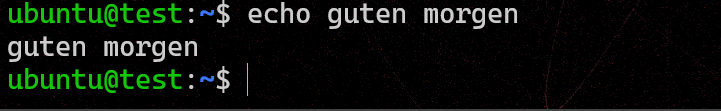
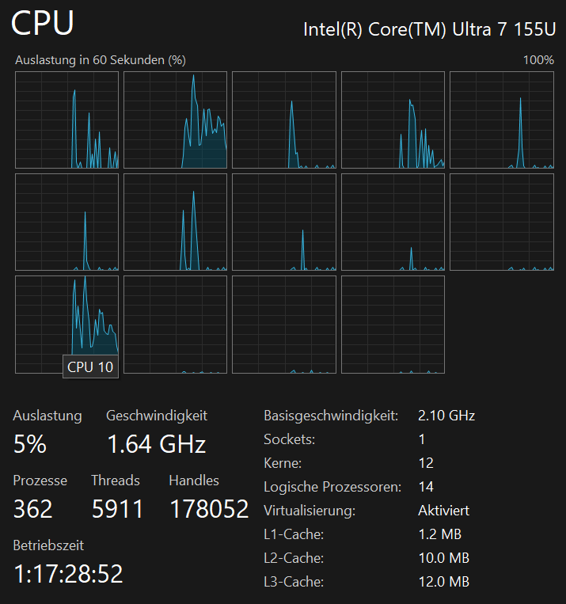
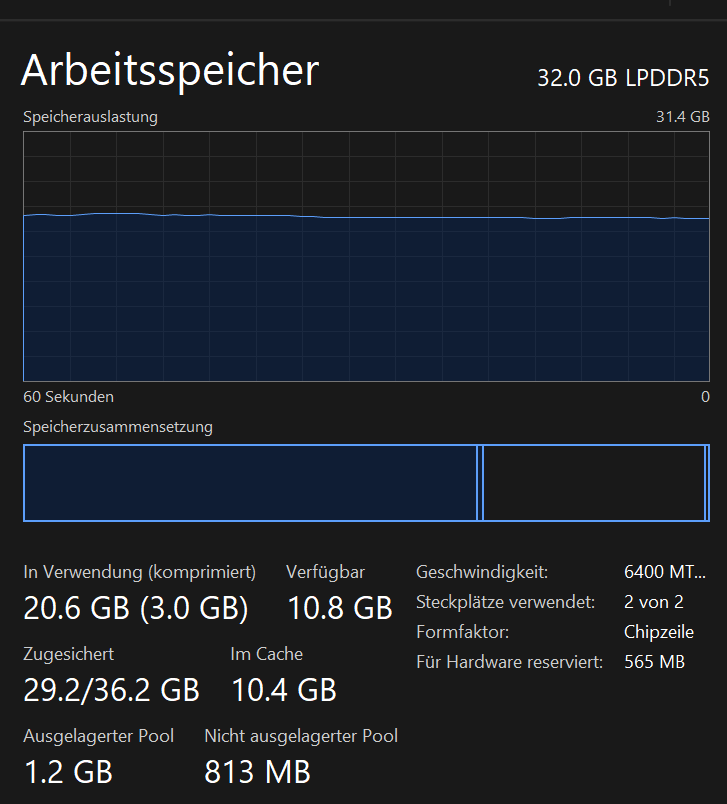
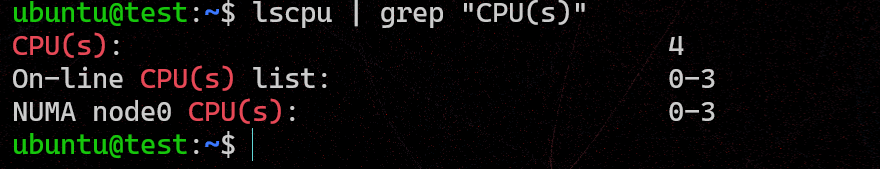
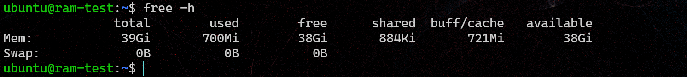
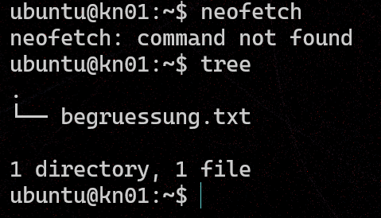

# Multi pass

Dies ist meine dokumentation von den aufgaben
KN01

## installation

### A2

Ich habe multipass nach anleitung installiert und habe folgende versionen getested.

|                        |                                 |
| ---------------------- | ------------------------------- |
| multipass vers         | multipass 1.17.0+win            |
| System vers            | Microsoft Windows 11 Enterprise |
| multipass local driver | hcs                             |

die vm konnte ich starten und auch darauf zugreiffen.

---



### A3

ich hatte zumglück keine problehme bis jetzt mit multipass.

## B) Hypervisor experiment (30%)

Hier sind meine stats...

## 



jetzt nach dem ich mein test instanz gerrunt habe habe ich mir zugriff auf die konsole erschaffen und den befehl

```shell
lscpu | grep "CPU(s)"
```

## das ergebnis wahr :



Jetzt musste ich eine instanz starten die 4 cores mer braucht als mein laptop das wahren bei mir 22 <br>
Ich bekahm dan diese nachricht zurück


der crash kommt daher das mann nur sovile threads hat und nicht mehr. deswegen konnte die vm keine weiteren cores finden / benutzen

---

das gleiche durften wier auch noch mit ram machen bei mir wahren es 40 GB ram<br>
das wahr das resultat:


irgendwie konnte tros dem 40 gb ram die ich brache die instanz starten obwohl ich nur 32 gb ram habe.



irgentwie funkzioniert diese vm auch wenn es nicht so viel rahm gibt. ich glaube der grund ist das der pc oder die vm ein teil vom ram im swap speichert also nicht auf dem ram.

## c1 Basis_konfiguration vestehen

ich habe mit dem gegebenen command

```shell
multipass launch --name kn01 --cloud-init cloud-init-basis.yaml 26.04
multipass shell kn01
```

eine instanz gestarted und getested ob es alles installiert hat.<br>
so habe ich es getested



und es hat, wie man siet, etwas nicht geklappt
