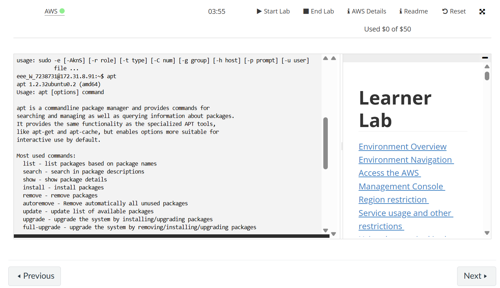
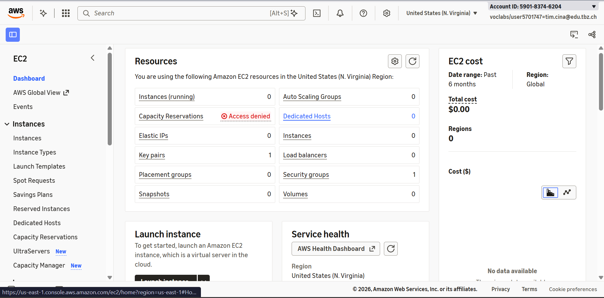
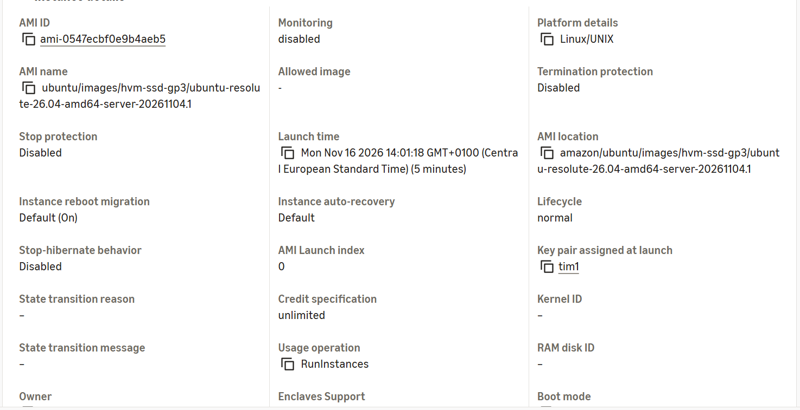
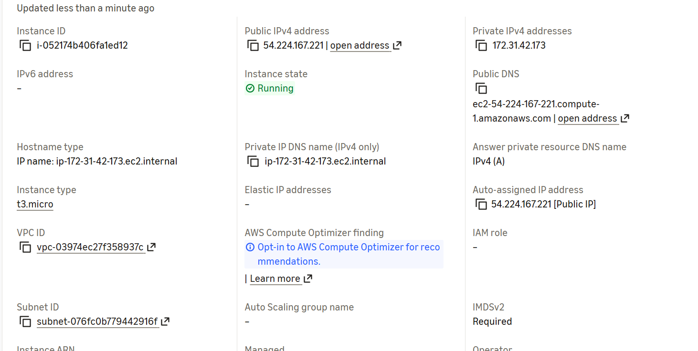
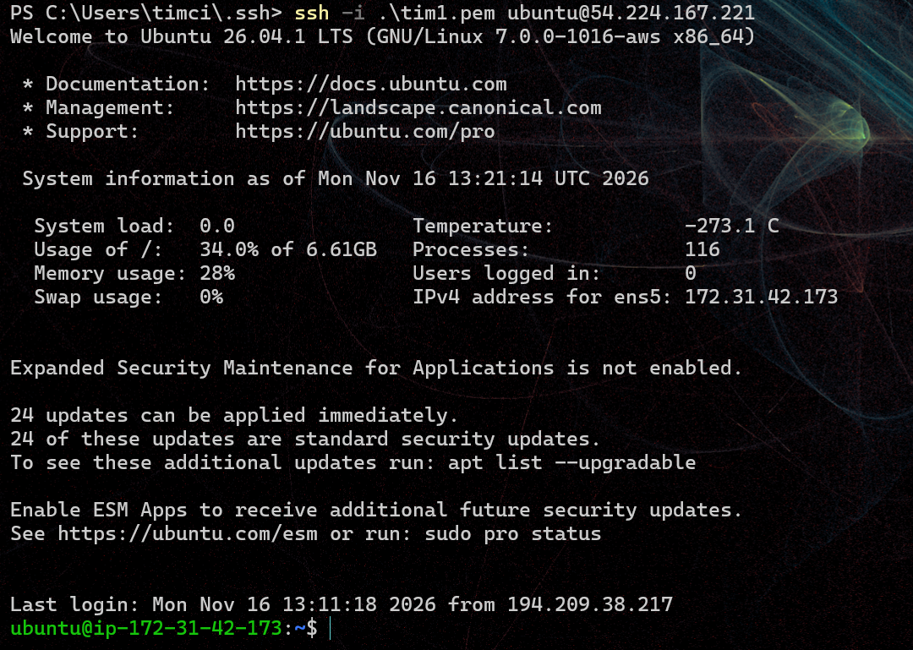
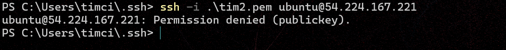
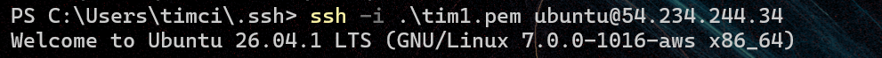
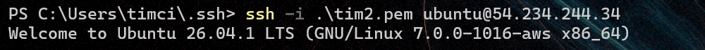
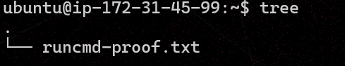
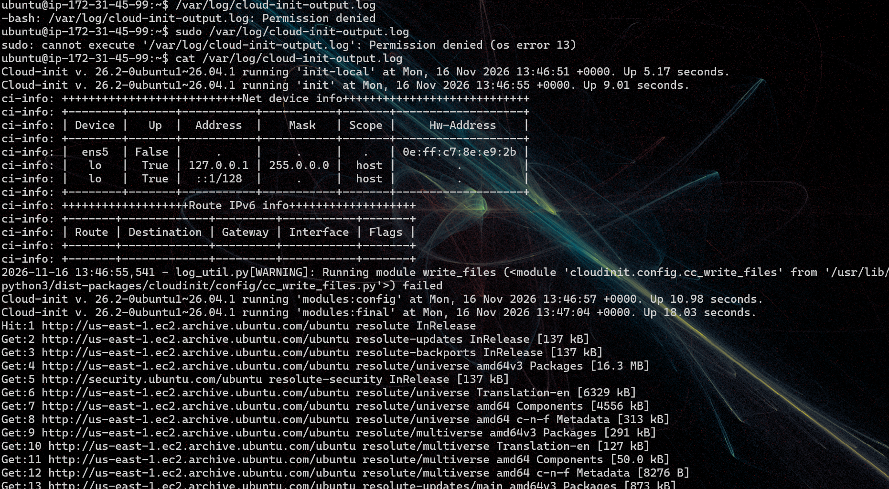

## ubuntu@ip-172-31-42-173

OS: Ubuntu 26.04.1 LTS (Resolute Raccoon) x86_64  
Host: t3.micro 
Kernel: Linux 7.0.0-1016-aws  
Uptime: 17 mins 
Packages: 680 (dpkg), 3 (snap) 
Shell: bash 5.3.9 
Terminal: /dev/pts/0 
CPU: Intel(R) Xeon(R) Platinum 8259CL (2) @ 2.50 GHz 
GPU: Amazon.com, Inc. Device 1111 (VGA compatible) 
Memory: 321.05 MiB / 908.64 MiB (35%) 
Swap: Disabled 
Disk (/): 2.25 GiB / 6.61 GiB (34%) - ext4 
Local IP (ens5): 172.31.42.173/20 
Locale: C.UTF-8 

### wiso ist mein public key ouf mineer cloud.

ich glaube das mein public key ouf meiner cloud ist damit nur ich auf meine cloud zugriff habe.

---

ich habe ausversehen den key 1 im yaml beim benutzer hinterlegt deswegen funkzioniert be mir user 1 und nicht 2.

## yaml doku

### pakeges

pakages installieren pakages wie zb nvim was essenzial ist.

### users

users erstellt users
der user ubuntu hat zwei keys damit ich und mein lehere auf meine cloud zugreiffen kann.

### Write files

mit write files können files erstellt werden.

### run cmd

mit run cmd kann ich konsolehn befehle beim start ausführen zb ein mandelbrot generator
