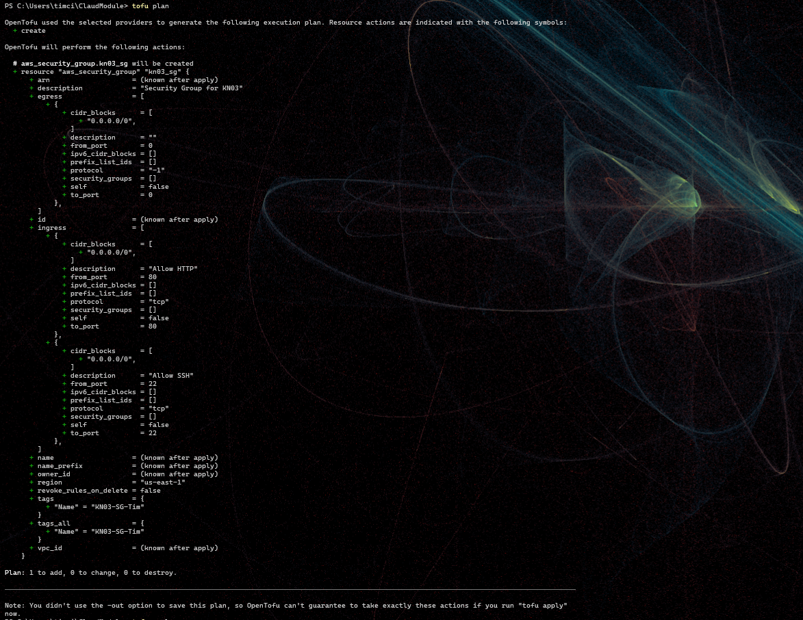
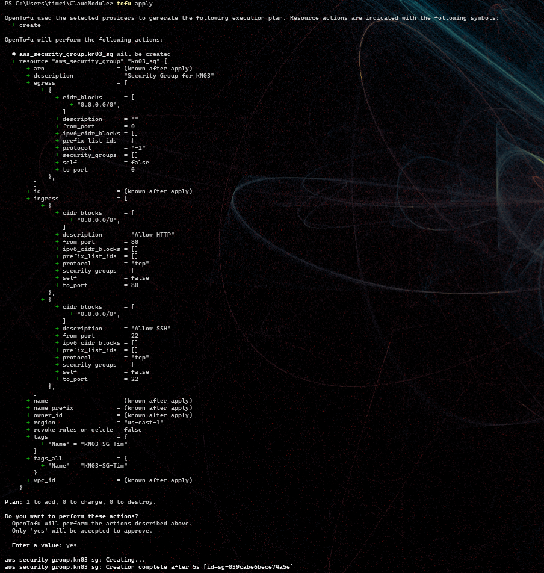
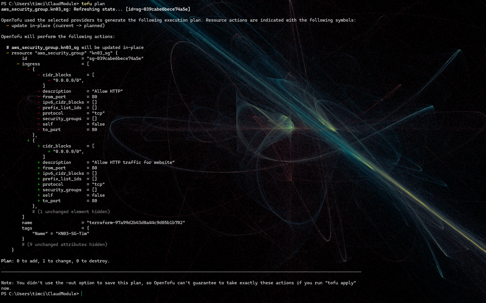
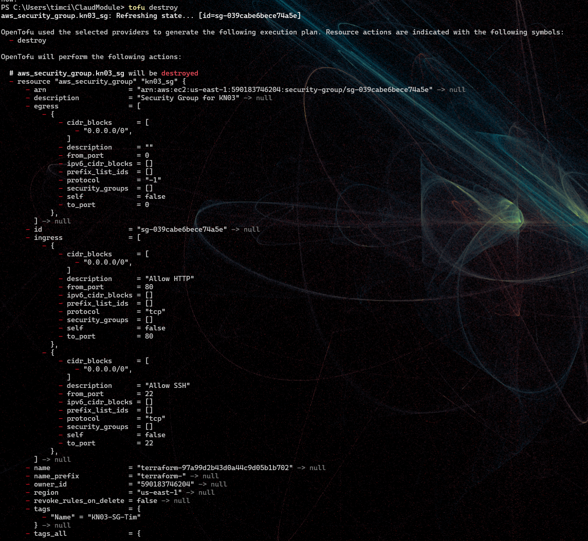
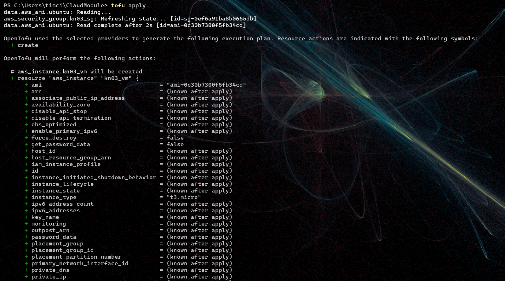
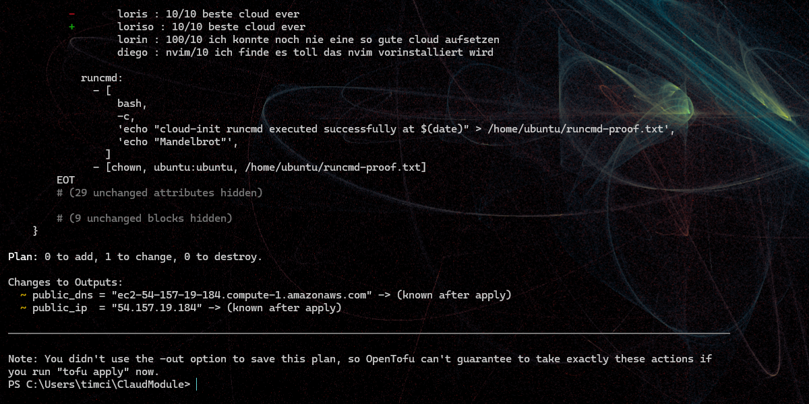

# Kn03

### Downloading OpneTofu

### Testing open tofu

after writing my main.tf file i ran `tofu plan` and it gave me a list of changes back.

after aplying these changes with `tofu apply` i receaved the a simular messsage but this thime the changes go actually aplyed

after applying these changes i chaged my main.tf file and the reran `tofu plan` as a contrary to last time when i also ran `tofu plan` after aplying these canges it told me that he had some changes that he could aply.

after running `tofu destroy`
tofu probably destroyed all the chagnes symbolized by the `-` the beginning of a file name.

### B1 konfiguration

after i changed my .tf file up with help of gpt so that it uses my yml file fromo kn2 to set the keys and so on i used `tofu apply` and this was the following message.

Bei einer änder ung im main.tf wurde es wie gewohnt angezeitg
bei einer veränderung im zb dem cloud init hat es mir überaschender weise die veränderung im file selber angezeigt.

